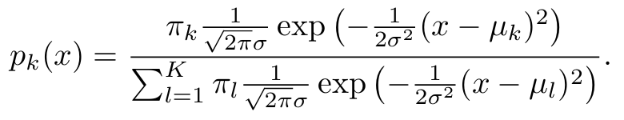
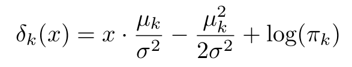
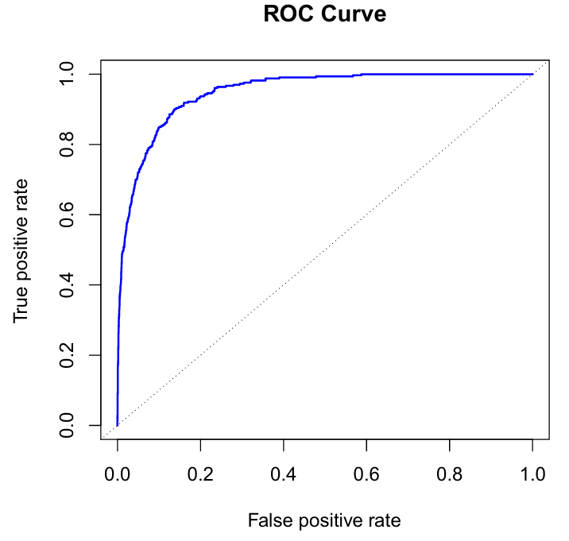
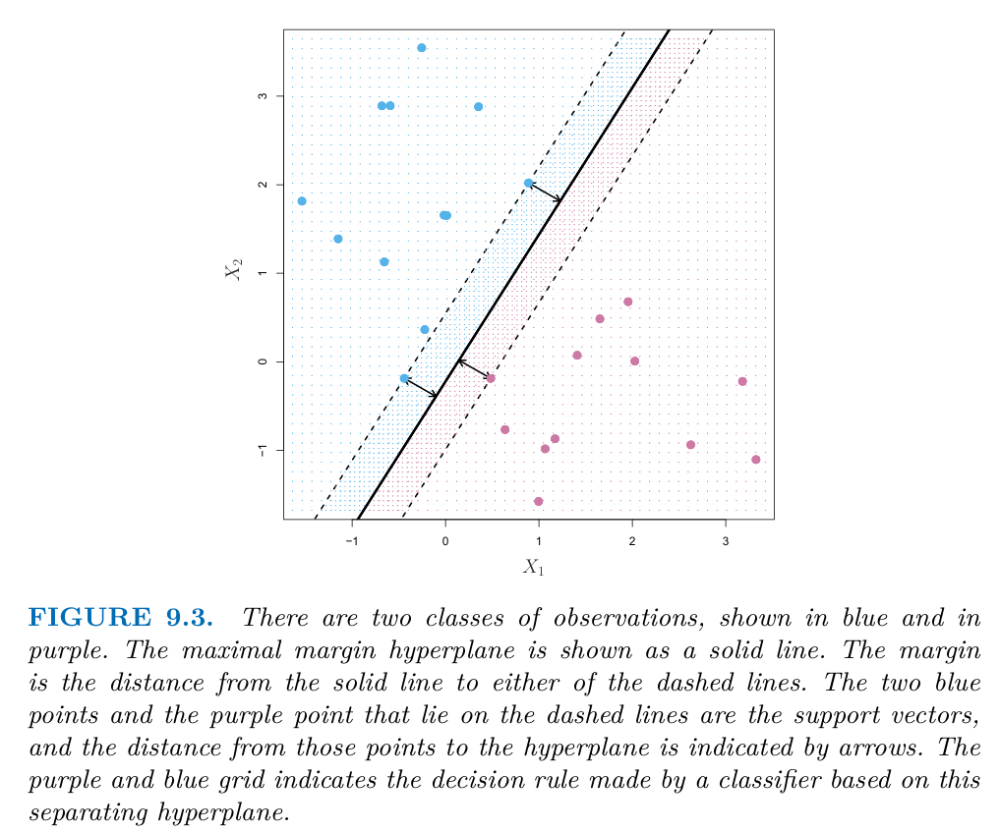
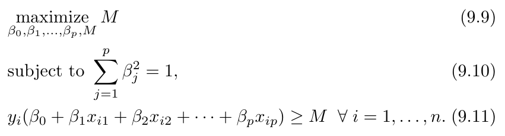
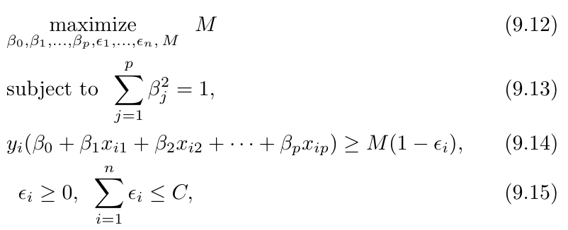
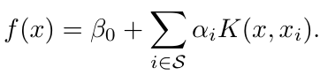
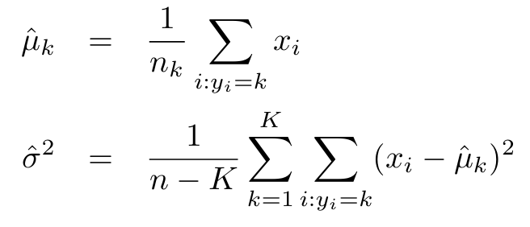

# Modelos generativos y discriminativos

## 0. Clasificador óptimo de Bayes
Bayes Classifier asigna la clase $k$ a $x$ al $\argmax_k P(Y=k | X=x)$

O tambien tomando logaritmo obtenemos la funcion discriminante..

Con:
- $\pi_k = P(Y=k|X)$

### The Bayes decision boundary
- The Bayes decision boundary is the point for which $δ_1(x)=δ_2(x)$.

### ROC

Manipulación del threshold $T$ para decidir si $f(x) = k$...
$$f(x) = k \iff P(Y=k|X=x) \geq T$$

>  It traces out two types of error as we vary the threshold value for the posterior probability of default. The actual thresholds are not shown. The ideal ROC curve hugs the top left corner, indicating a high true positive rate and a low false positive rate. The dotted line represents the “no information” classifier; this is what we would expect if student status and credit card balance are not associated with probability of default

- **The true positive rate is the sensitivity**: the fraction of defaulters that are correctly identified, using a given threshold value. 

- **The false positive rate is 1-specificity**: the fraction of non-defaulters that we classify incorrectly as defaulters, using that same threshold value. 

#### Tipos de errores en clasificadores
- **Error tipo 1**: Falso positivo
- **Error tipo 2**: Falso negativo

---
## 1. Modelos discriminativos
> En clase...
> P(Y=y | X=x) directo sin modelar P(X)

Ejemplos:
- LogReg,
- SVM,
- KNN

### 1.1 SVM: Support Vector Machine 

The support vector machine is a generalization of a simple and intuitive classifier called the maximal margin classifier.

#### 1.1.1 Maximal Margin Classifier

**Hiperplano**
In a p-dimensional space, a hyperplane is a flat affine subspace of hyperplane dimension p − 1. Its defined by
$$\beta_0 + \beta_1 X_1 + ... + \beta_p X_p = \beta X = 0$$

Ese plano define una frontera entre los $X$ que cumplen $\beta X > 0$ y los que $\beta X < 0$.

> A natural choice is the maximal margin hyperplane (also known as the maximal optimal separating hyperplane), which is the separating hyperplane that is farthest from the training observations. The maximal margin hyperplane is the separating hyperplane for which the margin is largest—that is, it is the hyperplane that has the farthest minimum distance to the training observations. 

- The maximal margin hyperplane depends directly on only a small subset of the observations (**support vectors**). It maximizes the minimum distance to the closest training instances (which are the support vectors).

**Construcción del MCC**

#### 1.1.2 Support Vector Classifier
> It could be worthwhile to misclassify a few training observations in order to do a better job in classifying the remaining observations.

The support vector classifier, sometimes called a soft margin classifier, rather than seeking the largest possible margin so that every observation is not only on the correct side of the hyperplane but also on the correct side of the margin, we instead allow some observations to be on the incorrect side of the margin, or even the incorrect side of the hyperplane.

**Construcción del SVM**

- $C$ hiperparámetro tuneable:  a budget for the amount that the margin can be violated by the n observations.

    When the tuning parameter C is large, then the margin is wide, many observations violate the margin, and so there are many support vectors.

    In contrast, if C is small, then there will be fewer support vectors and hence the resulting classifier will have low bias but high variance.

- $\epsilon_i$ son **Slack Variables** que dan un margen para que la frontera no tenga que ser 100% consistente a la separación de clases. 
    $\epsilon_i = 0 \implies \text{ observacion i en margen correcto}$
    $\epsilon_i > 0 \implies \text{ observacion i en margen incorrecto}$
    $\epsilon_i > 1 \implies \text{ observacion i en lado del hiperplano incorrecto}$

#### 1.1.3 Support Vector Machine

The support vector machine (SVM) is an extension of the support vector support classifier that results from enlarging the feature space in a specific way, using kernels. 

We see that the performance of linear regression can suffer when there is a non linear relationship between the predictors and the outcome. In that case, we consider enlarging the feature space using functions of the predictors, such as quadratic and cubic terms, in order to address this non-linearity. 

In the case of the support vector classifier, we could address the problem of possibly non-linear boundaries between classes in a similar way, by enlarging the feature space using quadratic, cubic, and even higher-order polynomial functions of the predictors. 

- S is the collection of indices of these support points, $α_i$ is nonzero only for the support vectors in the solution.

##### Kernels
A kernel is a kernel function that quantifies the similarity of two observations.

---

## 2. Modelos generativos

Usa $P(X|Y), P(Y)$ para estimar $P(Y|X)$.

$$P(Y|X) = \frac{P(Y)P(X|Y)}{P(X)}$$

- $P(Y)$ es facil de calcular
- $P(X|Y)$??

Los distintos clasificadores buscan estimadores de $P(X|Y)$

### 2.1 LDA: Linear Discriminant Analysis

- **Sesgo Inductivo**: Asumimos que $P(X|Y=k) \sim \mathcal{N}(\mu_k, \Sigma)$.

The linear discriminant analysis (LDA) method approximates the linear Bayes classifier by plugging estimates for $π_k$, $µ_k$, and $σ^2$. 

The word linear in the classifier’s name stems from the fact that the discriminant functions $\hat{δ}_k(x)$ are linear functions of x (as discriminant opposed to a more complex function of x).

- $π_k =n_k/n.$

Donde asumimos que podemos modelar para $X \in R^p$...
- $p=1 \implies P(X=x|Y=k) = \frac{1}{\sigma_k \sqrt{2\pi}} \, e^{ -\frac{(x - \mu_k)^2}{2\sigma_k^2} }$
- $p>1 \implies P(X=x|Y=k) = \frac{1}{|\Sigma|^{1/2} (2\pi)^{p/2}} \, e^{ - \frac{1}{2} (x-\mu)^T \Sigma^{-1} (x - \mu)} \land \sigma_k(x) = x^T \Sigma^{-1} \mu_k - \frac{1}{2} \mu_k^T \Sigma^{-1} \mu_k + \log \pi_k$

En particular, en LDA asumimos que $\forall k, j \in \text{Clases}: \sigma_k^2 = \sigma_j^2$ 

### 2.2 QDA: Quadratic Discriminant Analysis

- **Sesgo inductivo**: Asumimos que $P(X|Y=k) \sim \mathcal{N}(\mu_k, \Sigma_k)$.

Quadratic discriminant analysis (QDA), like LDA, results from assuming that the observations from each class are drawn from a Gaussian distribution, and plugging es timates for the parameters into Bayes’ theorem in order to perform prediction. 

However, unlike LDA, QDA assumes that each class has its own covariance matrix. That is, it assumes that an observation from the kth class is of the form $X \sim N(µ_k,Σ_k)$, where $Σ_k$ is a covariance matrix for the kth class. Under this assumption, the Bayes classifier assigns an observation $X = x$ to the class for which

> Computacionalmente es mucho más caro que LDA.

> In contrast, QDA is recommended if the training set is very large, so that the variance of the classifier is not a major concern, or if the assumption of a common covariance matrix for the K classes is clearly untenable.

### 2.3 Nahive Bayes

- **Sesgo inductivo**: Las features son independientes entre sí.

Nuevamente...
$$P(Y = k|X = x) = P(Y=k) * P(X=x | Y=k)$$
$$= \pi_k * P(X_1=x_1 \land \ldots \land X_p=x_p | Y=k)$$

Ahora asumo el sesgo, la independencia entre features...
$$= \pi_k * P(X_1=x_1|Y=k) * \ldots P(X_p=x_p | Y=k)$$

$$= \pi_k * f_{norm}(X_1=x_1; \mu_k^{(1)}; \sigma_{k,1}^2) * \ldots f_{norm}(X_p=x_p; \mu_k^{(p)}; \sigma_{k,p}^2)$$

While this may sound a bit like QDA, there is one key difference, in that here we are assuming that the predictors are independent; this amounts to QDA with an additional assumption that the class-specific covariance matrix is diagonal.

Por ejemplo, para $p=3$...
$$\Sigma_k = \begin{pmatrix} 
\sigma_{k,1}^2 & 0 & 0 \\
0 & \sigma_{k,2}^2 & 0 \\
0 & 0 & \sigma_{k,3}^2 \\
\end{pmatrix}$$

**We expect to see a greater pay-off to using naive Bayes relative to LDA or QDA in instances where p is larger or n is smaller, so that reducing the variance is very important**

- If $X_j$ is qualitative, then we can simply count the proportion of training observations for the jth predictor corresponding to each class.

