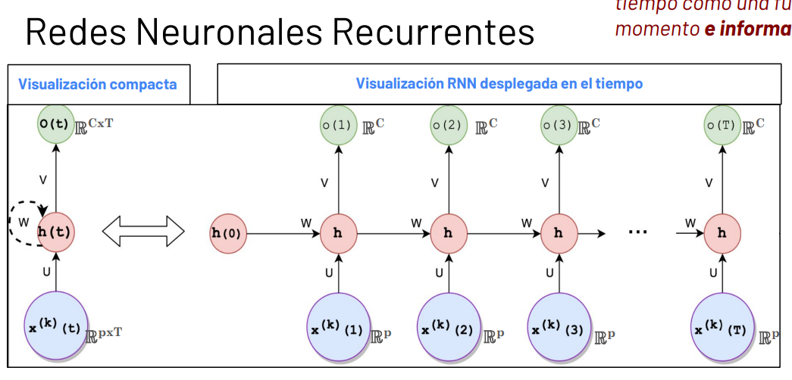
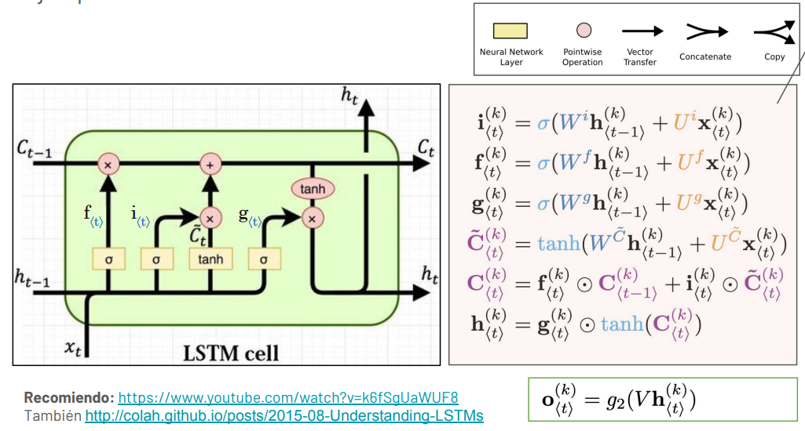
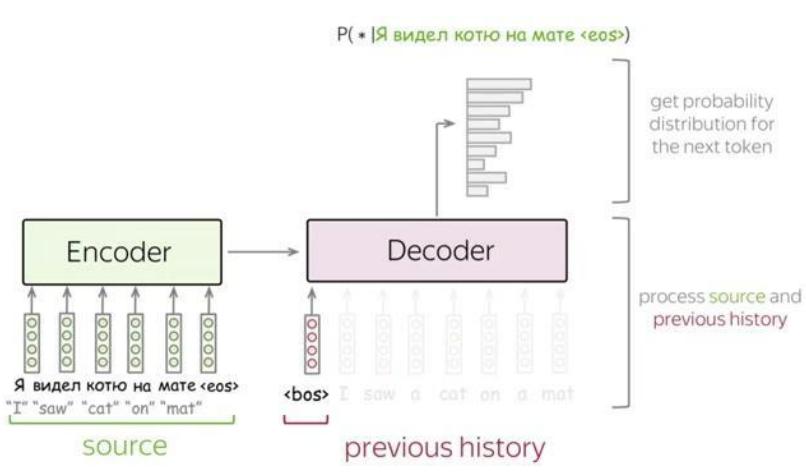
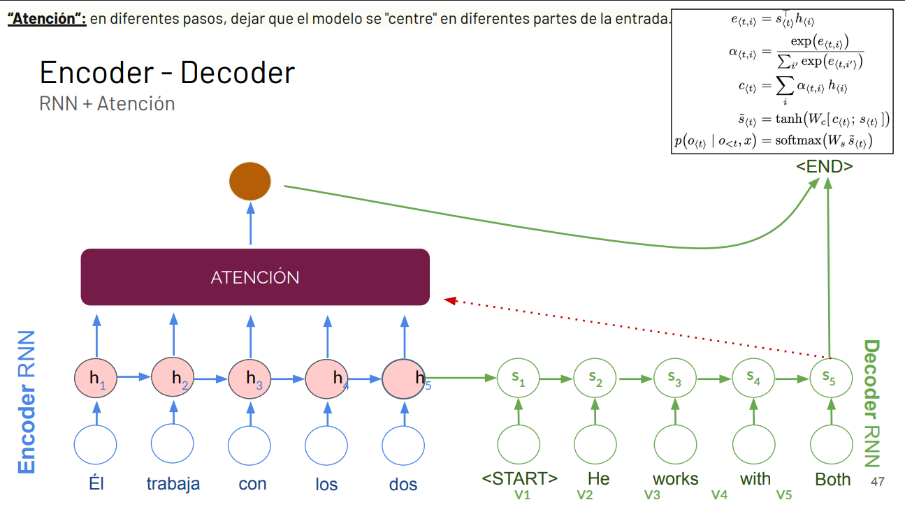

## RNN

> En toda RN la función de activación final está determinada por el problema.
> Si las funciones de activacion son la identidad --> Regresión Lineal (g'(g(X)) == W'W x = Z x).

---

## Problema predicción de secuencias

Por ejemplo: Clasificación de documentos.

### Posibles soluciones:

#### Representaciones clásicas

- BoW. 
    Ejemplo: (texto="Hola como estas" --> v=<0,0,1,0,1,1>, donde v_i = #v_i in texto)
    Contras:
        Vectores muy esparsos.
        No mantenes la cronología de la palabra (la palabra sin su contexto pierde información)

- Bag-Of-N-Grams
    Mantener n-palabras consecutivas y contar sus apariciones.
    Ejemplo: (3-gram="no-me-gusto" in text="no me gustó mucho la pelicula")

#### Nuevas representaciones

- Word-Embeddings: 
    La idea es que dos vectores están cerca si su significado es similar.
    Existen los contextuales (los + usados hoy en día) y no contextuales (FastText, GloVe, Word2Vec, BERT).

---
## Tipos de modelos de prediccion de secuencias

| Input | Output | Ejemplo |
| ---|---|---|
| 1 | Muchos | Recibe una imagen y responder "Veo un perro" |
| Muchos | 1 | Predecir sentimiento de una oración | 
| Muchos | Muchos | Predecir predio del dolar en un día (en distintos horarios) |
| Muchos | Muchos (desfasado)| Predecir siguientes tokens dados unos tokens iniciales / Traducción de texto (no hay alineación de palabra-palabra entre idiomas) |  

Vamos a ver el caso "Muchos a Muchos" ya que sirve para generalizar todos estos casos. 

### Muchos-a-Muchos

Sea $y^{(i)}, o^{(i)} \in \mathbb{R}^T$ los valores reales y predicción para cada instante $t < T$.

Si defino $J_{X,y} = \frac{1}{N} \sum_i^n L(o^{(i)}, y^{(i)})$ con $L(\{ o_1^(k),...,o_T^{(k)} \}, \{ y_1^(k),...,y_T^{(k)} \})$ el modelo va a tender a favorecer su performance en instancias largas ya que pesan más en la Loss. Para mitigar esto puedo, por ejemplo, manipularla ponderando por longitud de la instancias. 

$$J_{X,y} = \frac{1}{N} \sum_i^n \frac{1}{|o^{(i)}|} L(o^{(i)}, y^{(i)})$$

### Redes Neuronales Recurrentes 

Sean:
> $W$ conexiones recurrentes
> $V$ conexiones de salida
> $U$ conexiones del estado oculto actual

Definimos una recurrencia simple (memoria corta):

- $h_t^k = g_1(W o_{t-1}^k + U x_t^k) = g_1(\text{ output anterior + procesamiento de valor actual dentro de la instancia })$

- $o_t^k = g_2(V h_t^k)$

Definimos RNN clásicas cambiando la definición de $h_t^k$ (cambio $o_{t-1}^k \rightarrow h_{t-1}^k$):

- $h_t^k = g_1(W h_{t-1}^k + U x_t^k) = g_1(\text{ output anterior + procesamiento de valor actual dentro de la instancia })$

- $o_t^k = g_2(V h_t^k)$

Visualmente:

#### Entrenamiento

Para entrenar se usa descenso del gradiente: BPTT (Backpropagation Through Time) o TBPTT (Truncated Backpropagation Trough Time).

Problemas:

- Computo no paralelizable dentro de una instancia.
- Secuencia larga $\implies$ grafo computacional profundo.
- Matrices con máx valor singular < 1 $\implies$ Vanishing Gradients.
- Matrices con máx valor singular > 1 $\implies$ Exploiding Gradients.

$\therefore$ Instancias grandes implica dificultad para entrenar.

> Extra: **Teacher Forcing** ~ Inyectar las etiquetas en vez de outputs anteriores (cambio $o_{t-1} \rightarrow y_{t-1}$) para entrenar en paralelo al principio y luego volverlo a cambiar para que sea usable la red.

### LSTM / GRU  

---
**Observación**
> Se puede ajustar Many-2-Many a Many-2-One adaptando 
`loss(output, real) --> loss(output[:,-1], real)`

---

### Redes Recurrentes Bidireccionales (BRNN)

- $\overrightarrow{h_t^k} = g_1(\overrightarrow{W} \overrightarrow{h_{t-1}^k} + \overrightarrow{U} x_t^k)$

- $\overleftarrow{h_t^k} = g_1(\overleftarrow{W} \overleftarrow{h_{t+1}^k} + \overleftarrow{U}x_t^k)$

- $o_t^k = g_2(V [ \overleftarrow{h_{t}} , \overrightarrow{h_{t}^k}])$

Donde $[A,B] = AB$ es una concatenación de los vectores.

---

### Encoder - Decoder (con RNNs) 

Tipo de arquitectura que incluye un codificador y decodificador.

El encoder procesa la informacion de entrada y la acumula en estados ocultos. No saca outputs.

El decoder toma la informacion del encoder y devuelve una secuencia.

 

> Problema:
> Toda la informacion de entrada termina en un unico vector, es imposible que condense toda esa información --> cuello de botella en $h_s$.

---
### RNN + Atención (no la versión 2017) 

> Neural Machine Translation by Jointly Learning to Align and Translate - 2014/15.

Se plantea un vector de contexto distinto ($c_t$) para cada momento $t$.

$c_t = \sum_i^t \alpha_{t,i} h_i$

Defino...

- $\text{score de alineación entre el estado oculto del decoder en tiempo t y el hidden state i} = e_{t,i} = s_t^T h_i$

- $\alpha_{t,i} = \frac{\exp(e_{t,i})}{\sum_{i'}{\exp(e_{t,i})}}$

- $\hat{s}_t = \tanh(W_c [c_t; s_t])$

- $p(o_t | o_{<t, x}) = softmax(W_s \hat{s}_t)$

En resumen, se introduce

$$c_t = \text{Atencion}(s_t, H) = \text{softmax}(s_t H^T) H$$

Lo bueno es que no se suman pesos para estos scores, solo algunos en $W_c$ para sentido dimensional.